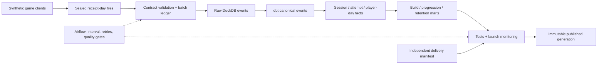

# Game telemetry analytics engineering

A runnable analytics system for two fictional game launches. It turns imperfect client telemetry into **one consistent definition of sessions, progression, play time and retention**, then checks whether a release changed game health or broke instrumentation.

**Implemented:** Python contract validation and transactional ingestion; DuckDB; a real dbt project with incremental event/session facts, tested marts and lineage; launch monitoring; immutable publication; Airflow task functions and a pinned Linux container configuration. **Deployment reference:** Redshift DDL, batch acceptance and performance diagnostics. No cloud deployment is claimed.

All data is synthetic. This independent project is not affiliated with Sony Interactive Entertainment or PlayStation, uses no proprietary telemetry, and makes no assumptions about their internal architecture.



**Start with the evidence:** [generated launch report](docs/example_outputs/report.md), [metric definitions](docs/metrics.md), [validation and known limits](docs/validation.md).

The default sample has 320 title-scoped players and roughly 27,000 accepted events, deliberately small enough to inspect. Atlas build 1.1.0 has a seeded crash regression and mission M02 bottleneck. Separate heartbeat and transport losses demonstrate why a gameplay change and an instrumentation failure need different investigations.

## Run it

Use Python **3.12** from the repository root. No database account or cloud credentials are needed. The lock file records the tested dependency set; packages are intentionally pinned, not presented as the newest releases.

```bash
python -m venv .venv
# macOS/Linux:
source .venv/bin/activate
# Windows PowerShell instead:
# .\.venv\Scripts\Activate.ps1
python -m pip install -r requirements.lock
python -m pip install --no-deps --no-build-isolation -e .
python -m telemetry demo --workspace .local/demo
```

`demo` generates the data, validates and deduplicates it, runs `dbt build` (including seeds and tests), generates dbt documentation, and publishes a report, five CSV marts and a queryable database. Repeating the command is safe with the same inputs and generator settings.

Open `.local/demo/published/current.json`. Its `report` and `database` paths are relative to that published directory and identify the **same immutable generation**. Keep the database basename when copying it: DuckDB views retain catalog-qualified references. The published artifact is a working database, not merely a rendered report.

```bash
# Tests execute real DuckDB and dbt, including bad-data gates and late-event repair.
python -m pytest tests orchestration/tests -q
python -m ruff check src tests orchestration scripts

# Full-size signal assertions and replay comparison; writes verification.json.
python scripts/verify_demo.py --workspace .local/verification
```

The editable installation is deliberate: the CLI uses the dbt project beside the Python source. Airflow runs separately in Linux; see [operations](docs/operations.md). Docker and AWS are not required for local analytics.

## Questions the models answer

| Studio / analyst question | Shared model and caveat |
|---|---|
| Did the release increase crashes or change session duration? | `mart_build_health`: crashed **sessions** / observed sessions; complete-session active-time averages; inspect partial share and player mix |
| Where do players die repeatedly or fail to finish? | `mart_progression`: client **attempt** grain, deaths per attempt and unfinished rate; unfinished is not proven abandonment |
| Are launch volumes arriving? | `mart_launch_health`: independent expected vs accepted receipts; retains zero-delivery days |
| Did a schema or instrumentation change break metrics? | Version/build/revision tests plus per-session heartbeat comparisons; v1 milliseconds and v2 seconds normalize to one counter |
| What are D1 / D7 by title, cohort and first build? | `mart_retention`: exact UTC-day returns, null immature rates, explicit delivery-quality qualifier |
| Are sessions and active players counted consistently? | `fct_sessions`, `fct_player_day`, `mart_daily_title`: client IDs and UTC event dates; no analyst-side sessionization |

## Engineering decisions

- **Immutable event identity:** `(title_id, event_id)`. Identical retransmissions are audited and deduplicated; changed payloads under the same identity reject the entire batch. Malformed rows cannot partially enter the warehouse.
- **Late arrivals:** newly accepted events receive a transactionally monotone `ingest_seq`. dbt recomputes the full history of affected sessions, including old starts. There is no event-time lookback that silently drops old arrivals.
- **Partial telemetry is visible:** no start/end timestamps are invented. Missing mission starts are pending for 48 hours of event time; expired or contradictory transitions fail publication.
- **Play time is measured:** cumulative active gameplay counters, separate from wall-clock duration. Counter increments are assigned to the reporting event's UTC day; exact within-interval midnight allocation is intentionally not claimed.
- **Retention can be restated:** first-observed cohorts, including their first build, are rebuilt when earlier activity arrives. A mature observation window is not proof of loss-free delivery; `has_delivery_gap` qualifies comparisons.
- **Publication is gated:** all dbt tests must pass. A content seal prevents publishing a warehouse changed after validation. Readers keep the preceding snapshot if the candidate fails. The local design requires one writer.
- **Scale selectively:** only events and sessions are incremental locally. The small downstream tables rebuild to preserve cohort and counter correctness. [Redshift design](docs/redshift.md) describes partition manifests, affected-key rebuilds, sort/distribution decisions and workload measurement needed at production volume.

## Repository map

| Path | Contents |
|---|---|
| `src/telemetry/` | Versioned JSON contract, deterministic generator, ingestion, CLI, publication and monitor |
| `dbt/` | Sources, seeds, dimensions/facts/marts, macros, generic and business-rule tests, exposure lineage |
| `orchestration/` | Real Airflow DAG, shared-volume task runtime, recovery tests and Docker Compose |
| `warehouse/redshift/` | Explicitly unexecuted cloud reference SQL and diagnostics |
| `tests/` | Contract, transactional loading, deterministic generation and actual dbt integration cases |
| `scripts/verify_demo.py` | Full synthetic signal assertions and rebuild equivalence |
| `data/sample/` | Synthetic scenario specification and expected receipt baselines; full receipt partitions are generated on demand |
| `docs/` | Metrics, event ownership, architecture, operations, scaling, generated evidence and review |

## Scope and tradeoffs

The sample models a session-based, mission-driven game. Session IDs do not merge account identities across devices or titles. Country is a coarse synthetic label; there are no emails, IP addresses or real player identifiers. Consent, account linking and erasure workflows would require separate product/privacy decisions before using real telemetry.

Airflow coordinates durable task boundaries; it is not used to process individual events. S3/COPY is the proposed warehouse ingestion boundary; AWS Glue has a bounded optional compaction/normalization role, documented rather than pretended to be deployed. Liquibase is intentionally omitted because dbt owns analytical DDL here and the small raw schema is versioned in Git. A separate migration system becomes useful when independently deployed producers and warehouse ownership require coordinated raw-schema changes.

The project does not simulate a massive dataset, distributed exactly-once delivery, an external pager, or a production SLA. [Validation notes](docs/validation.md) distinguish executed evidence from design guidance and explain the remaining limits.
